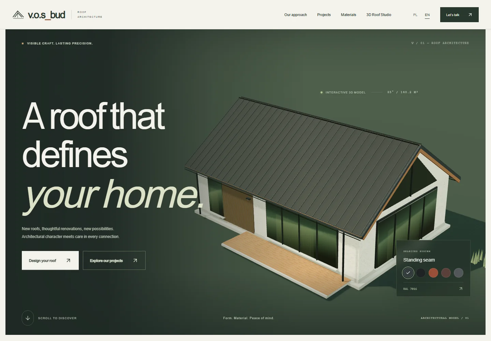
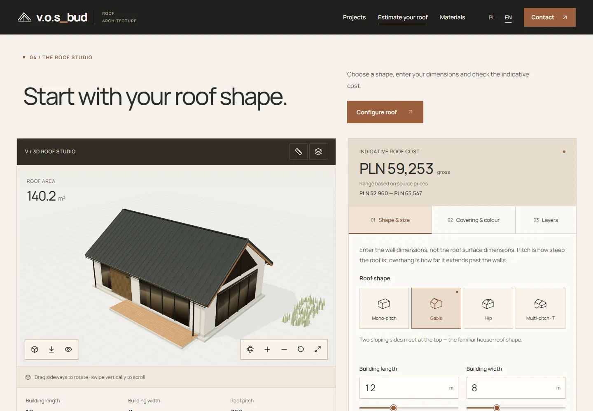
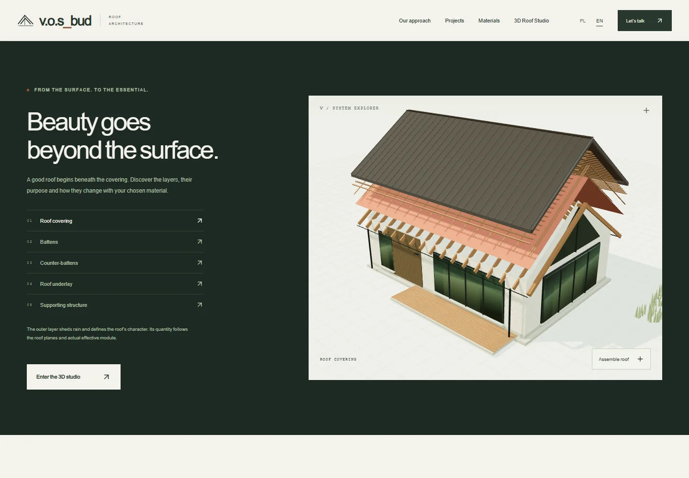
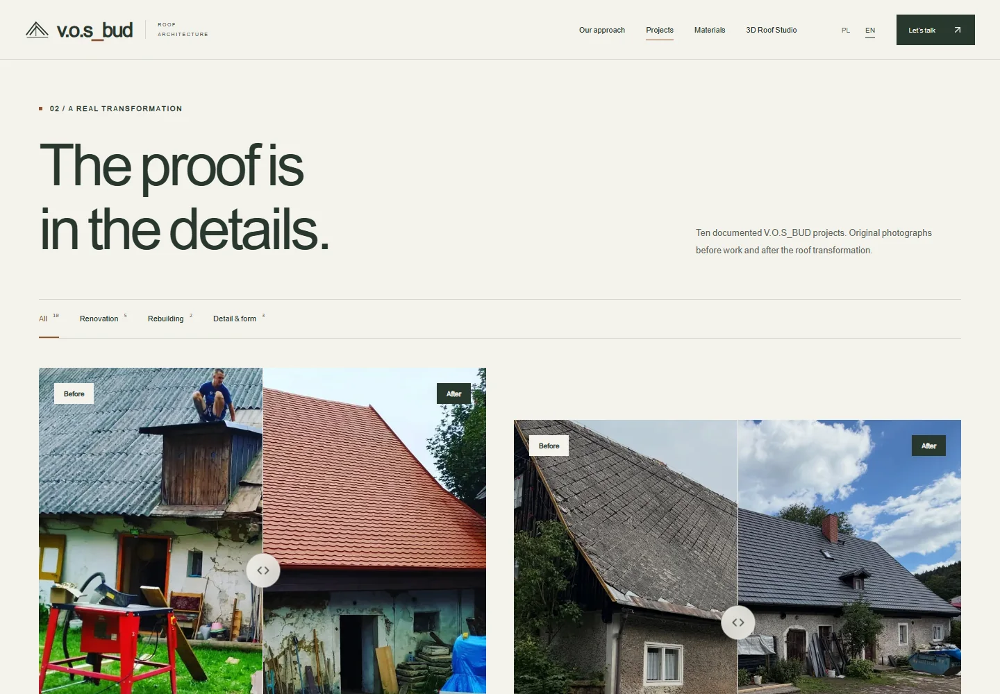
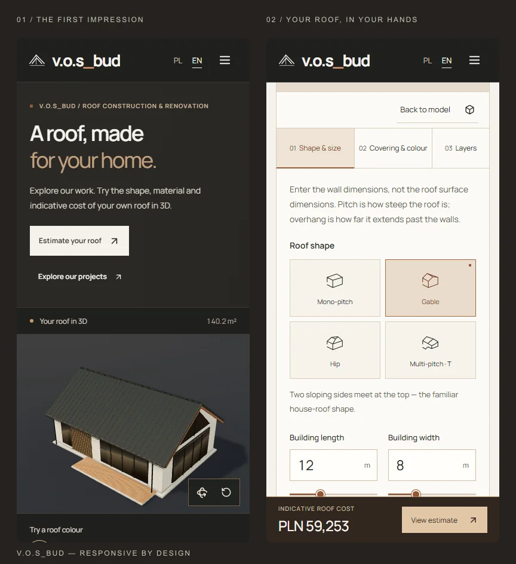
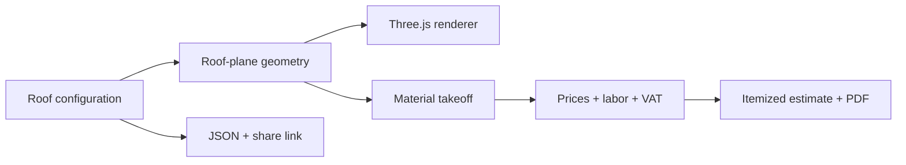

<div align="center">
  <h1>V.O.S_BUD · Roof Studio</h1>
  <p><strong>Architectural craft. Interactive decisions.</strong></p>
  <p>A roofing portfolio, parametric 3D studio and transparent cost estimator.<br>Built around real projects, real geometry and numbers you can inspect.</p>
  <p>
    <a href="https://github.com/DeFexNN/vos-bud-roof-studio/actions/workflows/pages.yml"></a>
    <a href="https://nextjs.org/"></a>
    <a href="https://threejs.org/"></a>
    
  </p>
  <p>
    <a href="https://defexnn.github.io/vos-bud-roof-studio/pl/"><strong>Explore in Polish</strong></a> ·
    <a href="https://defexnn.github.io/vos-bud-roof-studio/en/"><strong>Explore in English</strong></a> ·
    <a href="https://defexnn.github.io/vos-bud-roof-studio/en/studio/"><strong>Open the 3D studio</strong></a>
  </p>
</div>

[](https://defexnn.github.io/vos-bud-roof-studio/en/)

<p align="center"><strong>04 roof geometries &nbsp; / &nbsp; 06 material systems &nbsp; / &nbsp; 10 real transformations</strong></p>

<p align="center"><a href="#the-experience">Experience</a> · <a href="#getting-started">Getting started</a> · <a href="#one-model-two-consumers">Architecture</a> · <a href="#verification">Verification</a> · <a href="#documentation">Documentation</a></p>

## The experience

Most roofing websites show the finished result. This one connects **the work, the design and the budget** in a single experience.

| Explore | What happens |
| --- | --- |
| **[The portfolio](https://defexnn.github.io/vos-bud-roof-studio/en/projects/)** | Ten documented projects with original before/after photographs, draggable comparisons, fullscreen viewing and source Instagram posts. |
| **[The roof studio](https://defexnn.github.io/vos-bud-roof-studio/en/studio/)** | Change dimensions, roof shape, pitch, overhang, materials and openings. The actual 3D geometry changes—not just a label or a texture. |
| **[The material library](https://defexnn.github.io/vos-bud-roof-studio/en/materials/)** | Compare six reference systems on the same roof, with different assemblies, quantities, requirements and costs. |
| **[The estimate](https://defexnn.github.io/vos-bud-roof-studio/en/estimate/)** | Inspect each formula, purchase quantity, price source and installation task. Adjust net unit prices and export a genuine PDF. |

### Designed to be explored

<table>
  <tr>
    <td width="50%"><br><strong>Form, material, proportion.</strong><br>Four roof plans, six systems, orbit controls, cameras, measurements and modeled penetrations.</td>
    <td width="50%"><br><strong>Beauty beneath the surface.</strong><br>Animated roof layers explain how the selected construction assembly fits together.</td>
  </tr>
</table>

<details>
<summary><strong>View the photographic portfolio</strong></summary>



These are supplied photographs of V.O.S_BUD's work, not stock imagery. Different camera positions are disclosed; fullscreen viewing preserves the original proportions. Product brands in the estimator are independent reference choices, not claims about products visible in these photographs.

</details>

<details>
<summary><strong>View the mobile experience</strong></summary>

<p align="center"></p>

Responsive layouts, touch and keyboard comparisons, accessible controls, reduced-motion support and a geometry-based 2D fallback when WebGL is unavailable.

</details>

### More than a visualizer

- **Geometry-driven takeoffs.** Roof polygons and edge lengths drive covering, battens, underlay, accessories and drainage allowances.
- **Material-aware assemblies.** Shingles require decking and bituminous underlay; metal and tile systems use their own modules and batten gauges.
- **Explainable costs.** Source prices, purchase units, low/high rates, VAT and labor scopes are visible. Bundled installation replaces individual installation tasks.
- **Useful handoffs.** Download a Polish/English PDF, export/import configuration JSON, copy a share link or prepare a local inquiry document.
- **Static by design.** Pre-rendered PL/EN pages, self-hosted fonts, responsive WebP photography, lazy WebGL/PDF code and no required backend.

## Getting started

**Requirements:** Node.js **22+** and npm. Photos, fonts and procedural 3D materials are already included; no API key or database is required.

```sh
git clone https://github.com/DeFexNN/vos-bud-roof-studio.git
cd vos-bud-roof-studio
npm ci
npm run dev
```

Open **[localhost:3000/pl/](http://localhost:3000/pl/)** or **[localhost:3000/en/](http://localhost:3000/en/)**. Polish is the default; deliberate language selection and roof settings persist locally.

For a production preview, stop the development server, then:

```sh
npm run build
npm run preview
```

The deployable website is generated in **`out/`**. `npm start` is equivalent to `npm run preview`.

## One model. Two consumers.

The renderer and estimator share a **pure roof-plane engine**. There is no separate, approximate “calculator roof” hidden behind the 3D model.



The engine distinguishes projected area, gross sloping area, net area after openings, effective coverage and physical purchase area. Sheets, packs, rolls and stock timber are rounded to their actual purchase units. Price changes affect cost, **never geometry**.

**Roof plans:** mono-pitch · gable · hip · a defined intersecting-gable T roof.

**Reference systems:** Budmat Venecja · Pruszyński T18 · Ruukki Classic Design · swissporTON TITANIA · Braas Celtycka · IKO Superglass.

See [the calculation model](docs/CALCULATIONS.md) for formulas, assemblies, rounding rules and a reproducible default example.

<details>
<summary><strong>Source map and technology</strong></summary>

| Layer | Implementation |
| --- | --- |
| Pages and routing | Next.js 16 App Router, React 19, TypeScript, static export |
| 3D | Direct Three.js, OrbitControls, procedural geometry/materials, instanced elements |
| Estimation | Pure TypeScript geometry, takeoff, validation, price and VAT functions |
| Interface | Custom responsive CSS, PL/EN dictionaries, Manrope and DM Serif Display |
| Documents | Lazy-loaded jsPDF with embedded Noto Sans |
| Verification | Node test runner through tsx, Playwright, axe-core, optional PyMuPDF inspection |
| Hosting | GitHub Pages through GitHub Actions; no production Node server |

```text
src/
├── app/             Localized routes, metadata, sitemap and robots
├── calculators/     Geometry, quantities, validation and estimates
├── configurator/    Shared state, controls and construction layers
├── three/           Procedural house, rendering lifecycle and fallback
├── data/            Projects, product specifications and source prices
├── i18n/            Polish and English content
├── components/      Comparisons, gallery, cost table and exports
├── sections/        Public pages and the roof studio
└── tests/           Mathematical, pricing and localization tests
```

</details>

## Verification

The application was checked against both the local production export and its **real GitHub Pages subpath**, including rendered WebGL pixels, downloads and navigation—not only HTTP availability.

| Check | Verified result |
| --- | --- |
| Unit tests | **36 passed**, including exact area references and a 72-configuration grid |
| Public-site browser suite | **122 passed**, with no captured page exceptions or failed same-site responses |
| Supplemental browser flows | **13 passed**, including real touch events, share links, persistence, VAT and labor |
| Accessibility audits | **20 page/dialog audits**, zero violations in the tested axe WCAG A/AA rules |
| PDF inspection | PL/EN downloads, embedded Unicode fonts, Polish text extraction and page-bound checks |
| Responsive widths | **320 · 390 · 768 · 1024 · 1920 px** |

Recorded application verification: **26 October 2026**, revision [`7f56c9a`](https://github.com/DeFexNN/vos-bud-roof-studio/commit/7f56c9a32eea64f0586a6b3547267fa27a86c7b8). Details, evidence and scope: **[verification report](docs/QA.md)**. The build/deploy badge above reflects the current branch.

```sh
npm test
npm run docs:check
npm run build
npm run typecheck
```

With `npm run preview` running in another terminal:

```sh
npx playwright install chromium
npm run test:browser
npm run test:a11y
npm run test:extended
```

Do not rebuild `out/` while browser checks are running. These checks are not a WCAG certification, structural approval or a physical-device/cross-browser guarantee.

## Deployment

**The live site deploys automatically from `main`.** The [Pages workflow](.github/workflows/pages.yml) installs locked dependencies, validates documentation, runs unit tests, builds and type-checks the static export, then publishes it over HTTPS.

The workflow obtains the public origin and repository subpath from GitHub Pages. No hardcoded repository path is required in the application.

For another host or a custom domain, configure the build-time variables in [`.env.example`](.env.example). See **[deployment and configuration](docs/DEPLOYMENT.md)** for root/subdirectory hosting, preview commands and contact behavior.

## Scope and transparency

> [!IMPORTANT]
> This is a **planning estimate**, not a binding quotation, approved procurement schedule or structural/hydraulic design. The T roof is a defined plan, not an arbitrary roof/dormer editor. Transport, scaffolding, interior finishing and some bespoke details—including shingle ridge ventilation—are not priced.

**Prices:** reviewed **26 October 2026**, with dated manufacturer lists and qualified retail/labor references. Sources, publication dates, VAT normalization and update instructions are documented in [Pricing & evidence](docs/PRICING.md). Availability, accessory compatibility and final installation scope require professional confirmation.

**Contact:** the form validates and **downloads an inquiry document**; it does not pretend to send a message. The verified social channel is [@v.o.s_bud](https://www.instagram.com/v.o.s_bud/). An optional verified email enables a mail-client link, not a server-side delivery service.

**Privacy:** roof settings use localStorage; form details remain in page memory and the downloaded file. No analytics or submission backend is configured. Share links contain roof configuration and any price overrides, so share them deliberately.

## Documentation

| Guide | Purpose |
| --- | --- |
| [Documentation index](docs/README.md) | Find the right product or technical guide |
| [Calculation model](docs/CALCULATIONS.md) | Geometry, assemblies, purchase units, VAT and limitations |
| [Pricing & evidence](docs/PRICING.md) | Exact references, dates, assumptions and price-book updates |
| [Deployment](docs/DEPLOYMENT.md) | GitHub Pages, environment variables and other static hosts |
| [Verification](docs/QA.md) | Tested behavior, committed evidence and untested environments |
| [Contributing](CONTRIBUTING.md) | Development workflow and change-quality expectations |
| [Security](SECURITY.md) | Private vulnerability reporting and data boundaries |

### Rights and attribution

No open-source license has been selected for the application code. A public repository is not a blanket permission to reuse the code, photographs or brand assets; obtain the appropriate permission before reuse. Product names and trademarks belong to their respective owners. Bundled fonts retain their [OFL license notices](public/fonts/).

---

<p align="center"><strong>V.O.S_BUD — Roof architecture, made interactive.</strong><br><a href="https://defexnn.github.io/vos-bud-roof-studio/en/">Explore the live experience ↗</a></p>
